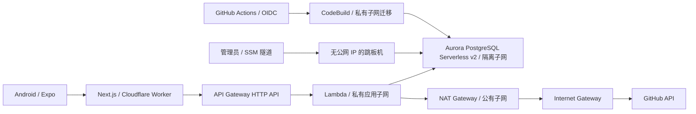

# Cloudflare、AWS 与 Android 部署流程

## 架构和费用边界



Lambda 与 Aurora 同一个 VPC，分别放在应用子网和数据库子网。私有 Lambda 不能直接通过 IGW 出网，必须经过公有子网的 NAT Gateway。API Gateway 提供入站 HTTPS 地址，与出站 NAT/IGW 分开。

当前模板使用两个可用区、一个 NAT、一个 Aurora writer，属于控制成本的基础部署。Aurora 最小 0、最大 2 ACU，空闲 300 秒后暂停；唤醒会增加首次请求等待。NAT、EBS、Aurora 存储、Secrets Manager 等仍计费，200 美元额度不是永久免费或费用上限。

免费计划账号创建普通 VPC Aurora 会被 AWS 拒绝，只有 Express 模式可用，而 Express 不符合本项目同 VPC 的要求。必须由账号持有人自行升级计划后才能执行这里的云资源创建。正常升级保留剩余额度；超出额度或额度不适用的用量可能向支付方式收费。不要通过加入 Organizations 的方式升级，因为这会影响免费额度资格。

## 1. 准备访问权限

本地使用 AWS CLI 浏览器登录，不需要在代码中存放访问密钥：

```bash
aws login --profile zyk-dyna-admin --region us-east-2
aws freetier get-account-plan-state --profile zyk-dyna-admin --region us-east-1
```

核对账号为 `181027096321`、区域 `us-east-2`、计划允许创建 VPC Aurora。GitHub CI 使用 `token.actions.githubusercontent.com` OIDC 提供商。如果 AWS 策略拒绝 IAM OIDC 操作，必须先解决账号权限限制；本地浏览器登录不能替代 GitHub CI 的身份配置。

## 2. 创建基础设施

模板在 `infra/production.yaml`。如果同名堆栈是此前失败后留下的 `ROLLBACK_COMPLETE`，先核对资源清单；只删除该失败堆栈，再重新创建。不要删除已有业务资源。

```bash
aws cloudformation deploy \
  --template-file infra/production.yaml \
  --stack-name zyk-dyna-admin-production \
  --capabilities CAPABILITY_IAM \
  --profile zyk-dyna-admin --region us-east-2
```

已有 GitHub OIDC 提供商时，添加参数 `--parameter-overrides GithubOidcProviderArn=实际提供商ARN`。模板把 GitHub 部署角色限定到 `i-zyk/zyk-dyna-admin` 的 `main` 分支，不给工作流创建基础设施的权限。

完成后在 CloudFormation 的 Outputs 中可查到 VPC、应用子网、数据库 endpoint、跳板机 ID、Secrets Manager ARN、迁移项目、制品桶和可选的 GitHub 角色 ARN。数据库密码和认证密钥自动生成，不写入仓库。

## 3. 部署 Lambda 和迁移数据库

先保证现有 HTTP API `jjdpgobje6` 的 `ANY /`、`ANY /{proxy+}` 都集成到函数 `zyk-dyna-admin`，使用 payload v2 和 `$default` 自动部署 stage，并具备调用 Lambda 的权限。

```bash
pnpm install --frozen-lockfile
pnpm run build:lambda
pnpm --dir apps/server run test:lambda
AWS_PROFILE=zyk-dyna-admin AWS_REGION=us-east-2 \
NEXT_PUBLIC_SERVER_URL=https://zyk-dyna-admin.izyk-me.workers.dev \
API_UPSTREAM_URL=https://jjdpgobje6.execute-api.us-east-2.amazonaws.com \
node scripts/aws/deploy.mjs
```

脚本上传不含本地 `.env` 和密钥文件的源代码包，通过 VPC 内的 CodeBuild 执行 `prisma migrate deploy`，再授予 `zyk_app` 业务表读写权限。应用不使用数据库管理员账号。迁移失败时停止部署，不更新 Lambda。

迁移通过后更新现有函数：Node.js 24、`index.handler`、512 MB、30 秒、应用子网和安全组，随后上传 ZIP 并检查 API 根路径返回 `OK`。数据库使用 TLS 验证 RDS 证书，连接池每个运行实例最多 3 个连接；预留并发为 5。

## 4. 配置 GitHub Actions

仓库 Settings → Secrets and variables → Actions：

| 类型 | 名称 | 值 |
| --- | --- | --- |
| Variable | `CLOUDFLARE_ACCOUNT_ID` | 现有 Cloudflare 账户 ID |
| Variable | `NEXT_PUBLIC_SERVER_URL` | `https://zyk-dyna-admin.izyk-me.workers.dev` |
| Variable | `API_UPSTREAM_URL` | `https://jjdpgobje6.execute-api.us-east-2.amazonaws.com` |
| Variable | `AWS_DEPLOY_ROLE_ARN` | 堆栈输出 `GithubRoleArn` |
| Secret | `CLOUDFLARE_API_TOKEN` | 现有 Workers 发布 Token |
| Secret | `EXPO_TOKEN` | 在 Expo 账号中创建的 CI access token |

- `Deploy Server to AWS`：main 上后端相关变更触发；测试、打包、OIDC 登录、迁移、部署和健康检查。
- `Deploy Web to Cloudflare`：main 上 Web/共享包相关变更触发；测试、OpenNext 构建、发布 Worker。
- `Build Android APK`：在 Actions 手动触发；类型检查后调用 EAS 构建可安装 APK。首次 Android 签名凭据须已在 EAS 项目中配置。

首次发布先完成后端，再发布 Web。后续涉及新增 API 或数据库字段时也遵循这个顺序；三个工作流分别运行，不应假设它们之间已经建立发布依赖。

浏览器访问 Web 的 `/api/auth/*` 和 `/trpc/*` 同源代理。`BETTER_AUTH_URL` 与 `CORS_ORIGIN` 都是 Web origin；Cookie 由浏览器自动管理，无需手填。环境变量变更后重新构建 Web。

## 5. 通过跳板机管理数据库

跳板机没有公网 IP，也不开放 SSH。使用 AWS Systems Manager Session Manager，电脑需要安装 AWS CLI、Session Manager plugin 和 PostgreSQL 客户端。

用堆栈输出的实例 ID 和数据库 host 替换下面占位值：

```bash
aws ssm start-session \
  --target 实际跳板机实例ID \
  --document-name AWS-StartPortForwardingSessionToRemoteHost \
  --parameters '{"host":["实际数据库host"],"portNumber":["5432"],"localPortNumber":["15432"]}' \
  --profile zyk-dyna-admin --region us-east-2
```

隧道保持运行，在另一个终端连接。下载官方 RDS CA 后使用 `sslmode=verify-full`；libpq 的 `host` 填实际数据库域名、`hostaddr` 填 `127.0.0.1`、`port` 填 `15432`，从而兼顾本地隧道和证书域名校验。密码从 Secrets Manager 管理员 secret 获取，使用交互式输入，不放进命令历史。

## 6. Android 安装与验收

Expo 项目：<https://expo.dev/accounts/izyk/projects/zyk-dyna-admin>。`apps/native/eas.json` 的 preview 生成 APK，production 生成 Google Play 使用的 AAB；本次目标是 APK 内部分发，尚未发布到应用商店。

```bash
cd apps/native
npx eas-cli@27.5.0 login
npx eas-cli@27.5.0 build --platform android --profile preview
```

下载构建完成后的 APK，在 Android 手机上安装。登录与 Web 相同的账号，确认能浏览、搜索、下拉刷新人员库，进入详情并打开 GitHub 页面。

上线验收：Web 注册/登录 → 搜索 GitHub 用户 → 加入人员库 → 修改名称和备注 → 刷新仍登录 → Android 显示同一人员 → Web 删除后 Android 刷新消失 → 退出后受保护接口返回未授权。

## 7. 费用和停用

在 Billing 中查看 Credits 的真实余额与到期日，并配置预算提醒。预算提醒不会自动停止 NAT、数据库或其他资源。闲置时可停止跳板机以减少实例计算用量，EBS 仍计费；Aurora 自动暂停也不会停止存储收费。

彻底停用需要逐项核对并删除资源。数据库启用删除保护且堆栈删除策略保留快照，制品桶保留，快照、S3 和其他残留资源可能继续计费。删除数据库或快照前先导出需要的数据。

参考：[AWS 计划与额度](https://aws.amazon.com/free/free-tier-faqs/)、[Aurora 自动暂停](https://docs.aws.amazon.com/AmazonRDS/latest/AuroraUserGuide/aurora-serverless-v2-auto-pause.html)、[Session Manager 数据库隧道](https://docs.aws.amazon.com/systems-manager/latest/userguide/session-manager-working-with-sessions-start.html)。
