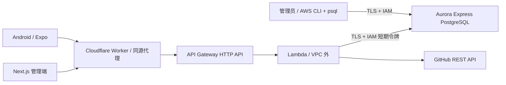

# 当前免费计划部署流程

本项目保留 AWS FREE 计划，使用已有的 200 美元额度；资源使用仍扣除额度，需在 Billing 查看余额和到期日，并非永久免费。



| 原要求 | 免费计划实际方案 |
| --- | --- |
| Next.js 管理 GitHub 人员 | 查询、入库、编辑展示名称/备注、确认删除 |
| Lambda 接口 | Node.js 24 + Hono + API Gateway |
| 私有 Lambda 经 NAT/IGW 出网 | Lambda 在 VPC 外，不创建 NAT |
| Lambda 与 Aurora 同 VPC | Express 无法加入 VPC，此要求已调整 |
| 跳板机管理数据库 | IAM + TLS 的 psql/pgAdmin/CloudShell，不创建 EC2 |
| GitHub Actions | Web 自动发布、Server 测试和 ZIP 制品、Android APK 构建；AWS 自动发布受 OIDC 策略限制 |
| Android 展示 | 登录、搜索、分页、下拉刷新、详情和 GitHub 链接 |

原 VPC 架构保留在 [vpc-deployment.md](vpc-deployment.md) 和 `infra/production.yaml`，不属于当前免费部署，不要在本账号执行它。

## 地址与配置

- Web：`https://zyk-dyna-admin.izyk-me.workers.dev`
- API：`https://jjdpgobje6.execute-api.us-east-2.amazonaws.com`
- Lambda：`zyk-dyna-admin`，区域 `us-east-2`
- Aurora：`zyk-dyna-admin-free`，PostgreSQL Express
- 数据库：`zyk_dyna_admin`；应用角色：`zyk_app`
- Lambda IAM 角色：`zyk-dyna-admin-free-lambda`，日志权限和指定数据库用户的连接权限
- Expo 项目：<https://expo.dev/accounts/izyk/projects/zyk-dyna-admin>

Lambda 设置 `DATABASE_AUTH_MODE=iam`、`DATABASE_AWS_REGION=us-east-2`。`DATABASE_URL` 只含用户名、endpoint 和数据库名，不含密码。SDK 通过 Lambda 执行角色为每个新连接生成短期令牌，不能把令牌固定存进环境变量。

本地继续使用默认的 `DATABASE_AUTH_MODE=password` 和原连接串。共享数据库包通过配置接收密码回调，不自行读取环境变量或 AWS 凭证。

Aurora 容量为 0–1 ACU，闲置 300 秒后暂停。IAM 模式的 Lambda 在请求结束时关闭数据库连接，避免冻结的运行环境保留连接而阻止暂停。首次恢复访问会有唤醒延迟。

## 发布后端

安装 Node.js 24 和根 `packageManager` 指定的 pnpm，从仓库根目录运行：

```bash
aws login --profile zyk-dyna-admin --region us-east-2
pnpm install --frozen-lockfile
pnpm run build:lambda
pnpm --dir apps/server run test:lambda
node --test scripts/aws/*.test.mjs

AWS_PROFILE=zyk-dyna-admin AWS_REGION=us-east-2 \
NEXT_PUBLIC_SERVER_URL=https://zyk-dyna-admin.izyk-me.workers.dev \
API_UPSTREAM_URL=https://jjdpgobje6.execute-api.us-east-2.amazonaws.com \
node scripts/aws/deploy-free.mjs --bootstrap
```

首次使用 `--bootstrap` 创建 Express 和应用 Lambda 角色；后续更新省略该参数。脚本要求账户仍为 FREE，不升级计费计划，也不重建已有数据库。

脚本先通过管理员 IAM 身份创建/确认数据库，执行现有 Prisma migrations，授予 `zyk_app` 业务表读写权限；迁移成功后更新 Lambda 配置与 ZIP，再检查 API 根路径。迁移失败就停止发布。应用不使用数据库管理员身份。

Prisma Migrate 使用 `sslmode=require&sslaccept=strict`，IAM 令牌经 URL 编码以保留其已有百分号转义。运行时 pg 直接使用密码回调和严格 TLS。ZIP 打包移除类型代码生成指令，兼容 Lambda 只读部署目录。

## GitHub Actions

仓库 Settings → Secrets and variables → Actions：

| 类型 | 名称 | 值 |
| --- | --- | --- |
| Variable | `CLOUDFLARE_ACCOUNT_ID` | 当前 Cloudflare 账户 ID |
| Variable | `NEXT_PUBLIC_SERVER_URL` | 上述 Web 地址 |
| Variable | `API_UPSTREAM_URL` | 上述 API 地址 |
| Secret | `CLOUDFLARE_API_TOKEN` | Workers 发布令牌 |
| Secret | `EXPO_TOKEN` | Expo CI access token |

Expo 令牌在 [Expo Access tokens](https://expo.dev/accounts/izyk/settings/access-tokens) 创建，只保存到 GitHub Secret，不发到聊天、不提交代码。

- **Deploy Web to Cloudflare**：main 相关变更触发测试、OpenNext 构建、发布；也可手动执行。
- **Build and deploy Server**：PR/main 后端变更触发测试、构建 ZIP，上传 `server-lambda` 制品并保留 7 天。账号此前拒绝 GitHub OIDC 提供商创建，因此未配置 `AWS_DEPLOY_ROLE_ARN`，工作流会明确记录 AWS 发布跳过。实际 AWS 发布使用本地 CLI。
- **Build Android APK**：Actions → Run workflow，选择 main；通过 EXPO_TOKEN 调用 EAS 构建 APK，完成后从日志中的 Expo 链接下载。

不要把 Server CI 成功理解为 AWS 自动发布已完成。未来策略允许 OIDC 后，需配置有迁移和应用发布权限的角色，填写 `AWS_DEPLOY_ROLE_ARN`，使用 `AWS_DEPLOYMENT_MODE=free`。不使用长期 AWS 密钥绕过当前策略。

## Web、Cookie 与 Android

`NEXT_PUBLIC_SERVER_URL` 是 Web 同源地址，`API_UPSTREAM_URL` 是实际 API 地址。浏览器请求 `/api/auth/*`、`/trpc/*`，由 Worker 转发并保留 Cookie 和多个 Set-Cookie，用户响应禁止缓存。

Lambda 的 `BETTER_AUTH_URL`、`CORS_ORIGIN` 都是 Web origin。浏览器自动保存 Cookie，无需手填；Server Component 转发 Cookie 校验 session。修改部署变量后重新构建 Web。

首次使用时在 Web 注册自己的账号。当前沿用原型已有权限模型：所有登录用户可以管理共享人员库。

`apps/native/eas.json` 的 preview 输出可安装 APK，production 输出 Play Store 使用的 AAB。本次为 APK 内部分发，未上架 Google Play。Android 使用相同账号登录，展示同一份数据库资料。

验收：注册/登录 → 搜索并加入 GitHub 用户 → 修改名称/备注 → 刷新仍登录 → Android 下拉刷新显示 → Web 删除 → Android 刷新后消失 → 退出后保护接口拒绝访问。

## 数据库管理

不使用静态数据库密码或跳板机。安装 AWS CLI 和 PostgreSQL 客户端后，可使用 IAM 登录；令牌有效 15 分钟，重连时重新生成。

```bash
export PGHOST=zyk-dyna-admin-free.cluster-c1wkai4g2ni4.us-east-2.rds.amazonaws.com
export PGPORT=5432
export PGDATABASE=zyk_dyna_admin
export PGUSER=zyk_admin
export PGSSLMODE=verify-full
export PGSSLROOTCERT=system
PGPASSWORD="$(aws rds generate-db-auth-token \
  --hostname "$PGHOST" --port "$PGPORT" --username "$PGUSER" \
  --profile zyk-dyna-admin --region us-east-2)" psql
```

本机客户端需支持系统 CA 信任库。也可从 RDS → Connectivity & security → CloudShell 连接。不要关闭证书验证，不要用生产数据库执行会清表的 E2E。

## 额度与停用

定期查看 Billing 中的余额和期限。自动暂停不等于存储免费；当前没有 NAT 或 EC2 持续运行费用。不要为延长部署自动升级计划。

数据库启用删除保护。停用时先备份数据，再由账号持有人决定是否解除删除保护、删除数据库、Lambda/API 和保留的快照。

参考：[Aurora Express 的限制和 IAM 连接](https://docs.aws.amazon.com/AmazonRDS/latest/AuroraUserGuide/CHAP_GettingStartedAurora.AuroraPostgreSQL.ExpressConfig.html)、[AWS 免费计划](https://aws.amazon.com/free/free-tier-faqs/)。
