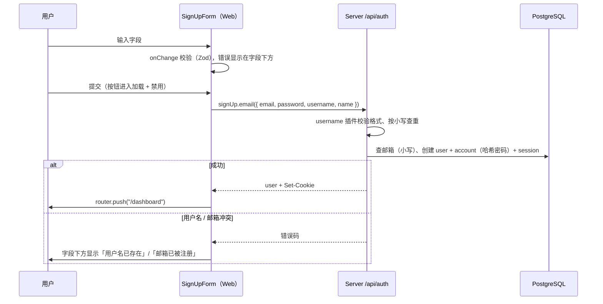

# R01 用户名 + 邮箱注册 - 技术设计

> 技术参考：[AGENTS.md](../../AGENTS.md)

## 技术约定

- 认证使用 Better Auth 1.7（邮箱密码 + `@better-auth/expo` 插件），表单 / 校验使用 TanStack Form + Zod 4，Web UI 使用 shadcn/ui（`base-lyra`，基于 `@base-ui/react`）（AGENTS.md「技术栈」）
- 共享包不读取环境变量，`createAuth(env, db)` 是工厂函数，唯一组装点是 `apps/server/src/services.ts`（AGENTS.md「架构要点 / 依赖注入（工厂模式）」）
- Better Auth 由 `/api/auth/*` → `auth.handler` 处理注册、登录和 session；Cookie 为 `sameSite: "none"`、`secure`、`httpOnly`，Web 端 fetch 用 `credentials: "include"`（AGENTS.md「架构要点 / 请求链路」「认证与跨端」）
- 不要手改 `auth.prisma`，用 `pnpm run auth:generate` 重新生成；改 schema 后执行 `db:generate`，再 `db:migrate`（AGENTS.md「开发约定」「常用命令」）
- 只属于 Web 的业务组件放 `apps/web/src/components`，共享组件从 `@zyk-dyna-admin/ui/components/<name>` 导入（AGENTS.md「开发约定」）
- 不要手改生成文件：`*/src/env.ts`、`packages/db/prisma/generated/`、`next-env.d.ts`（AGENTS.md「开发约定」）
- 开启了 React Compiler，`noJsxPropsBind` 关闭，可以直接写内联回调（AGENTS.md「开发约定 / Lint 规则的取舍」）
- Web 端读取环境变量统一用 `import { ENV } from "@/env"`（AGENTS.md「开发约定 / Lint 规则的取舍」）
- 正则用顶层字面量；输入框都要有 `<label>`；不得保留 `console.log`；代码需通过 Ultracite（AGENTS.md「Ultracite Code Standards」）
- `apps/web` 用的是新版 Next.js 16，写代码前先查 `apps/web/node_modules/next/dist/docs/`（apps/web/AGENTS.md）

## 方案概述

1. 服务端：在 `createAuth` 的 `plugins` 中加入 Better Auth 官方 `username()` 插件，使用默认配置（3–30 位、默认校验器 `^[a-zA-Z0-9_.]+$`、统一转小写存储到 `username`、原样保存到 `displayUsername`）。保留 `emailAndPassword: { enabled: true }`，不开启 `requireEmailVerification`，`autoSignIn` 保持默认（开启），这样注册成功后直接拿到 session，且已注册邮箱会返回明确的 `USER_ALREADY_EXISTS_USE_ANOTHER_EMAIL` 错误码（开启邮箱验证或关闭自动登录时，Better Auth 会改为返回通用成功响应，无法提示「邮箱已被注册」）。
2. 数据库：执行 `pnpm run auth:generate` 重新生成 `auth.prisma`（新增 `username String? @unique`、`displayUsername String?`），再执行 `pnpm run db:generate` 和 `pnpm run db:migrate`。
3. Web 客户端：`authClient` 加 `usernameClient()`，让 `signUp.email` 接受 `username`，`session.user` 带上 `username` / `displayUsername` 类型。
4. 注册表单：字段改为用户名、邮箱、密码、确认密码，前端用与插件相同的规则做实时校验（`onChange`），提交时调用 `authClient.signUp.email({ email, password, username, name: username })`；服务端返回的错误码映射成中文提示显示在对应字段下方。
5. `/login` 页面：保留「登录 / 注册」切换，文案改为中文。技术参考未规定默认显示哪个面板，暂按默认显示「登录」、可切换到「注册」。（R02 会把该页改为 Server Component 并加已登录重定向，本需求只调整表单与切换。）
6. 测试基础设施：Vitest（单元 / 集成）+ Playwright（Web E2E），已确认（见 requirements.md「已确认事项」）。E2E 连本地 PostgreSQL 18 的独立测试库 `zyk_dyna_admin_test`：测试配置从 `DATABASE_URL` 只替换库名得到测试库连接串，以环境变量覆盖的方式传给 server，测试前 `prisma migrate deploy` 并清空业务表；全程不读取、不打印 `.env` 里的密码。
   - 实现细节（W4a 补充）：测试库连接串由 `apps/web/e2e/support/database-url.ts` 通过 `varlock printenv DATABASE_URL`（在 `apps/server` 下执行，进程环境变量优先于 `.env`，已实测）在内存中得到，只替换库名；连接前断言库名为 `zyk_dyna_admin_test`。数据库校验与清表用 `pg`（Web 的 devDependency，只在 E2E 代码中使用）。web 的 Vitest 配置用 `.mts`，原因是 `apps/web` 不是 `"type": "module"`，`.ts` 会触发 Vite 的 CommonJS 警告；同理 Playwright 以 CommonJS 加载 e2e 文件，`e2e/support/paths.ts` 只能用 `__dirname`（已加 biome-ignore 说明）。webServer 设置 `reuseExistingServer: false`，避免复用连接开发库的服务，所以跑 E2E 前 3000 和 3001 端口必须空闲。
   - 实现细节（W4a 任务 6 补充）：为了检查「日志中不出现明文密码」（6.4），server 的 webServer 命令改为 `mkdir -p … && pnpm exec tsx src/index.ts 2>&1 | tee apps/web/test-results/e2e-server.log`（webServer 命令由 sh 执行；Playwright 在启动 webServer 前清空 `test-results`，该目录已被 git 和 Biome 忽略）。E2E 用例与配置共用的地址抽到 `e2e/support/urls.ts`。`sign-up.spec.ts` 每个用例前清空业务表；准备已存在用户时直接调用 `POST /api/auth/sign-up/email`（带可信 `Origin`）。注意：`next dev` 每次启动都会按 Next 内置模板重写 `apps/web/AGENTS.md` 的 `nextjs-agent-rules` 块（标题从 `#` 变成 `##`），跑完 E2E 后需要 `git checkout -- apps/web/AGENTS.md` 还原。

## 涉及模块 / 文件

| 文件 | 改动 |
| --- | --- |
| `packages/auth/src/index.ts` | `plugins: [expo(), username()]`，`username` 从 `better-auth/plugins/username` 导入（W4a：用子路径避免整包 barrel 导入，符合 AGENTS.md「Prefer specific imports」） |
| `packages/db/prisma/schema/auth.prisma` | 由 `pnpm run auth:generate` 重新生成，不手改 |
| `packages/db/prisma/migrations/<时间戳>_<名称>/migration.sql` | 由 `pnpm run db:migrate` 生成（首个迁移） |
| `apps/web/src/lib/auth-client.ts` | `plugins: [usernameClient()]`，从 `better-auth/client/plugins` 导入 |
| `apps/web/src/lib/auth-validation.ts`（新建） | 用户名 / 邮箱 / 密码的常量与 Zod schema（`signUpSchema`），R02 复用 |
| `apps/web/src/lib/auth-errors.ts`（新建） | Better Auth 错误码 → 中文文案的映射函数 |
| `apps/web/src/components/sign-up-form.tsx` | 重写字段、校验、错误展示与提交状态 |
| `apps/web/src/components/sign-in-form.tsx` | 仅改切换按钮文案（登录逻辑由 R02 改） |
| `apps/web/src/app/login/page.tsx` | 默认显示登录面板，切换文案中文化 |
| 测试相关（已确认）：根 `package.json`、`turbo.json`、`pnpm-workspace.yaml` 的 `catalog:`（`vitest`、`@playwright/test`、`pg`、`@types/pg`）、`apps/web/vitest.config.mts`、`packages/api/vitest.config.ts`、`apps/web/playwright.config.ts`、`apps/web/e2e/`（`global-setup.ts`、`support/`）、`apps/web/src/**/*.test.ts` | 新增测试脚本与配置 |
| `apps/web/tsconfig.json`、`apps/web/.gitignore`、`biome.json` | tsconfig 的 `include` 加 `**/*.mts`；忽略 Playwright 产物（`test-results` 等）并在 Biome 中排除 |

## 数据模型

`user` 表（由 `auth:generate` 生成，以生成结果为准）：

| 字段 | 类型 | 说明 |
| --- | --- | --- |
| `username` | `String? @unique` | 小写规范化后的用户名，用于唯一性判断和用户名登录 |
| `displayUsername` | `String?` | 用户输入的原样用户名，用于展示 |
| `name` | `String` | Better Auth 必填字段，注册时直接填用户名（原样） |
| `email` | `String @unique` | Better Auth 写入前统一转小写 |

密码只存在 `account.password`（Better Auth 哈希），业务代码不读取、不记录。

## 接口设计

不新增自定义接口，使用 Better Auth 自带端点（经 `/api/auth/*`）：

- `POST /api/auth/sign-up/email`，body：`{ email, password, username, name }`
  - 成功：返回 user 与 session，并通过 `Set-Cookie` 写入 session cookie
  - 用户名已占用：`400`，`code: "USERNAME_IS_ALREADY_TAKEN"`
  - 邮箱已注册：`422`，`code: "USER_ALREADY_EXISTS_USE_ANOTHER_EMAIL"`
  - 用户名不合法：`422`，`code: "USERNAME_TOO_SHORT" | "USERNAME_TOO_LONG" | "INVALID_USERNAME"`
  - 密码长度不合法：`code: "PASSWORD_TOO_SHORT" | "PASSWORD_TOO_LONG"`

前端校验规则（`apps/web/src/lib/auth-validation.ts`，与插件默认值保持一致）：

| 字段 | 规则 | 提示文案（暂定） |
| --- | --- | --- |
| 用户名 | 必填；3–30 位；`/^[a-zA-Z0-9_.]+$/` | 「请输入用户名」「用户名需为 3–30 位」「用户名只能包含字母、数字、下划线和点」 |
| 邮箱 | 必填；`z.email()` | 「请输入邮箱」「邮箱格式不正确」 |
| 密码 | 必填；8–128 位 | 「请输入密码」「密码需为 8–128 位」 |
| 确认密码 | 必填；与密码一致（`refine`，`path: ["confirmPassword"]`） | 「请再次输入密码」「两次输入的密码不一致」 |

错误码映射（`apps/web/src/lib/auth-errors.ts`）：

| 错误码 | 显示位置 | 文案 |
| --- | --- | --- |
| `USERNAME_IS_ALREADY_TAKEN` | 用户名字段下方 | 用户名已存在 |
| `USER_ALREADY_EXISTS_USE_ANOTHER_EMAIL` / `USER_ALREADY_EXISTS` | 邮箱字段下方 | 邮箱已被注册 |
| `USERNAME_TOO_SHORT` / `USERNAME_TOO_LONG` / `INVALID_USERNAME` | 用户名字段下方 | 对应格式提示 |
| `INVALID_EMAIL` | 邮箱字段下方 | 邮箱格式不正确（W4a 补充） |
| `PASSWORD_TOO_SHORT` / `PASSWORD_TOO_LONG` | 密码字段下方 | 密码需为 8–128 位（W4a 补充） |
| 其他 / 网络错误 | `toast.error` | 注册失败，请稍后再试 |

实现细节（W4a 补充）：
- `auth-validation.ts` 导出长度常量、`USERNAME_PATTERN`、`AUTH_VALIDATION_MESSAGES`，以及 `usernameSchema` / `emailSchema` / `passwordSchema` / `signUpSchema`（R02 可单独复用字段 schema）。各字段的「必填」检查带 `abort: true`，为空时只显示「请输入…」一条；邮箱先 `trim()` 再 `pipe(z.email())`，解析结果是 trim 后的值。确认密码的 `refine` 用 Zod 4 的 `when`，其他字段有错时也照常检查两次密码是否一致；确认密码为空时只提示「请再次输入密码」。
- `auth-errors.ts` 导出 `getSignUpError(code)`，返回 `{ field, message }`，`field` 为 `"username" | "email" | "password" | undefined`（`undefined` 表示用 toast）；查表用 `Object.hasOwn`，避免 `toString` 这类错误码命中原型链。
- 注册表单（任务 5）用字段级 `onChange` 校验（`usernameSchema` / `emailSchema` / `passwordSchema`，确认密码用 `onChangeListenTo: ["password"]` 的函数校验，规则与 `signUpSchema` 的 `refine` 一致），而不是表单级 `signUpSchema`：表单级 onChange 会在用户输入第一个字段时就给其余空字段报「请输入…」。提交时 TanStack Form 会先把所有字段标记为 touched 再跑全部 onChange 校验，所以空字段仍会被拦下；`onSubmit` 里再用 `signUpSchema.safeParse` 兜底并取 trim 后的邮箱。确认密码只因密码变化被触发、且用户还没碰过时，不提示「请再次输入密码」。
- 服务端字段错误存在组件 state 里，与前端校验错误合并显示在字段下方，该字段再次输入时清除；输入框带 `aria-invalid` 和指向错误文案的 `aria-describedby`。表单加 `noValidate`，避免浏览器原生邮箱校验气泡抢在中文提示之前。注册成功后到跳转完成前按钮保持加载 + 禁用（`isRedirecting`），防止跳转前重复提交。切换按钮去掉写死的 `text-indigo-*` 颜色，错误文案用 `text-destructive`，保证暗色主题下对比度。

## 关键流程

## 异常与边界情况

- 用户名大小写：`Tom` 和 `tom` 由插件统一转小写后查重，提示「用户名已存在」。
- 用户名和邮箱同时冲突：插件的 before hook 先检查用户名，此时只提示「用户名已存在」，可以接受。
- 首尾空格：用户名不允许空格，前端不自动 trim，直接报格式错误；邮箱输入前端 trim 后再校验和提交（技术参考未规定，暂按 trim）。
- 密码长度边界：8 位和 128 位可以提交，7 位和 129 位不可以。
- 重复提交：用 `form.Subscribe` 的 `isSubmitting` 禁用按钮；回车重复触发也被 TanStack Form 的提交状态拦住。
- 注册成功但跳转前刷新：session cookie 已写入，刷新后 `/dashboard` 的服务端 session 校验能通过。
- 已有老用户（`username` 为空）：仍可用邮箱登录，不受影响。
- 服务端返回字段错误后用户再次修改该字段：清除对应的服务端错误，恢复为前端实时校验结果。

## 风险与取舍

- **测试框架（已确认）**：使用 Vitest（单元 / 集成）+ Playwright（Web E2E），已同意新增 devDependencies。E2E 使用可随意清空的测试库 `zyk_dyna_admin_test`（owner `postgres`），连接账号与开发库相同，只换库名；不读取、不打印 `.env` 中的密码。需要确认 varlock 允许用进程环境变量覆盖 `DATABASE_URL`，否则改用其他不暴露密码的注入方式。
- **首个迁移（已确认）**：`migrations/` 为空，`db:migrate` 会生成首个迁移。本地开发库是刚装的空库、从未 `db:push`、没有需要保留的数据，Prisma 要求时可以重置。
- **前后端规则重复**：前端不能在运行时导入 `@zyk-dyna-admin/api` / `auth`（AGENTS.md「依赖关系」：前端只导入类型），所以用户名规则在 `auth-validation.ts` 中按插件默认值重写一份；以后改插件配置时要同步修改。
- **`auth:generate` 依赖网络**：脚本使用 `pnpm dlx auth@latest`，需要能访问 npm；生成结果要人工核对只新增了 `username`、`displayUsername` 两个字段。
