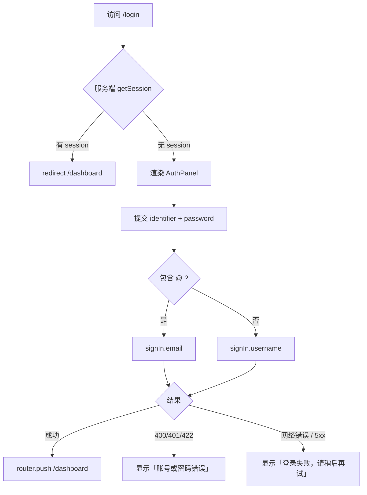

# R02 用户名或邮箱登录 / 退出登录 - 技术设计

> 技术参考：[AGENTS.md](../../AGENTS.md)

## 技术约定

- 认证使用 Better Auth 1.7，表单 / 校验使用 TanStack Form + Zod 4，Web UI 使用 shadcn/ui（AGENTS.md「技术栈」）
- `/api/auth/*` 由 Better Auth 处理登录、session；Cookie 为 `sameSite: "none"`、`secure`、`httpOnly`，Web 端用 `credentials: "include"`（AGENTS.md「架构要点 / 请求链路」「认证与跨端」）
- Web 的 `dashboard/page.tsx` 是 Server Component，用 `authClient.getSession` 并转发 `headers()` 校验登录（AGENTS.md「架构要点 / 认证与跨端」）；`/login` 的已登录重定向沿用同一做法
- Web 前端：Next.js 16 App Router、`typedRoutes`、React Compiler（AGENTS.md「技术栈」）；写代码前先查 `apps/web/node_modules/next/dist/docs/`（apps/web/AGENTS.md）
- 只属于 Web 的业务组件放 `apps/web/src/components`，共享组件从 `@zyk-dyna-admin/ui/components/<name>` 导入（AGENTS.md「开发约定」）
- `noJsxPropsBind` 关闭，可以写内联回调（AGENTS.md「开发约定 / Lint 规则的取舍」）
- 输入框都要有 `<label>`、使用语义化元素、键盘可操作；不保留 `console.log`（AGENTS.md「Ultracite Code Standards」）

## 方案概述

1. **登录表单**：`sign-in-form.tsx` 字段改为「用户名或邮箱」（`identifier`）和「密码」，只做必填校验（不在登录时校验密码长度或用户名格式，避免泄露规则差异）。提交时 `identifier.trim()` 后判断是否包含 `@`：包含则 `authClient.signIn.email({ email, password })`，否则 `authClient.signIn.username({ username, password })`。
2. **统一错误**：登录返回任何认证类错误（`INVALID_EMAIL_OR_PASSWORD`、`INVALID_USERNAME_OR_PASSWORD`、`INVALID_EMAIL`、`USERNAME_TOO_SHORT`、`USERNAME_TOO_LONG`、`INVALID_USERNAME`，即 HTTP 400 / 401 / 422）时，统一显示「账号或密码错误」；网络错误或 5xx 显示「登录失败，请稍后再试」（技术参考未规定，暂按此区分，二者都不透露账号是否存在）。映射函数放进 R01 的 `auth-errors.ts`。登录失败提示以 `role="alert"` 的行内文字显示在提交按钮上方（不用 toast，便于读屏和测试），修改任一输入框时清除。
3. **`/login` 已登录重定向**：把 `apps/web/src/app/login/page.tsx` 改成 Server Component，按 `dashboard/page.tsx` 的方式 `authClient.getSession({ fetchOptions: { headers: await headers() } })`，有 session 就 `redirect("/dashboard")`；否则渲染新的客户端组件 `auth-panel.tsx`（原页面里的登录 / 注册切换状态移到这里）。与 `dashboard/page.tsx` 不同，这里不传 `throw: true`：取 session 失败（如 server 不可用）时按未登录处理，仍显示登录表单，而不是让登录页报错。
4. **`/dashboard` 未登录重定向**：现有 `dashboard/page.tsx` 已有该逻辑，保留并补测试。
5. **用户菜单**：`user-menu.tsx` 触发按钮显示用户名（`displayUsername ?? username ?? name`，已确认），下拉中显示用户名和邮箱，菜单项「退出登录」调用 `authClient.signOut`，成功后 `router.push("/login")` 并 `router.refresh()`，清掉 App Router 缓存的已登录页面；退出失败时 toast 提示「退出登录失败，请稍后再试」。未登录时显示按钮样式的「登录」链接（`<Link>` + `buttonVariants`，语义是链接，避免原来 `<Link><Button>` 的交互元素嵌套）。文案统一中文。触发按钮限宽并截断过长的名字；`header.tsx` 根元素加 `min-w-0`，避免导航栏最小内容宽度撑宽根布局的 grid 列，保证 375px 下顶部导航不出现横向滚动。

## 涉及模块 / 文件

| 文件 | 改动 |
| --- | --- |
| `apps/web/src/components/sign-in-form.tsx` | 重写字段、校验、提交分支和错误展示 |
| `apps/web/src/components/field-messages.tsx`（新建） | 从 `sign-up-form.tsx` 抽出的字段错误展示（`toMessages`、`FieldMessages`、`getFieldA11yProps`），登录 / 注册表单共用 |
| `apps/web/src/components/sign-up-form.tsx` | 改为从 `field-messages.tsx` 导入上述工具，不改行为 |
| `apps/web/src/lib/auth-validation.ts` | 新增 `signInSchema`（`identifier`、`password` 必填）与 `isEmailIdentifier()` |
| `apps/web/src/lib/auth-errors.ts` | 新增 `getSignInErrorMessage()` |
| `apps/web/src/app/login/page.tsx` | 改为 Server Component，已登录重定向 |
| `apps/web/src/components/auth-panel.tsx`（新建） | 客户端组件，承载登录 / 注册切换 |
| `apps/web/src/components/user-menu.tsx` | 显示用户名 + 邮箱，「退出登录」后跳 `/login` |
| `apps/web/src/components/header.tsx` | 布局微调（`min-w-0`、`gap-2`），窄屏下由用户菜单按钮截断名字，不出现横向滚动 |
| `apps/web/src/app/dashboard/page.tsx` | 保持未登录重定向，不改逻辑 |
| `apps/web/src/lib/auth-validation.test.ts`、`apps/web/src/lib/auth-errors.test.ts`、`apps/web/e2e/sign-in.spec.ts` | 测试 |

## 数据模型

无（使用 R01 新增的 `username` / `displayUsername` 字段，不改表结构）。

## 接口设计

不新增自定义接口，使用 Better Auth 自带端点：

| 端点 | body | 失败时 |
| --- | --- | --- |
| `POST /api/auth/sign-in/email` | `{ email, password }`（服务端转小写查找） | `401 INVALID_EMAIL_OR_PASSWORD`；格式不合法 `400 INVALID_EMAIL` |
| `POST /api/auth/sign-in/username` | `{ username, password }`（插件转小写查找） | `401 INVALID_USERNAME_OR_PASSWORD`；长度 / 格式不合法 `422 USERNAME_TOO_SHORT` 等 |
| `POST /api/auth/sign-out` | 无 | — |
| `GET /api/auth/get-session` | — | 未登录返回 `null` |

前端判断规则：`const isEmail = identifier.includes("@")`。

## 关键流程

## 异常与边界情况

- 用户名大小写：插件默认把输入转小写再查，`TOM` 能登录 `tom` 的账号。
- 邮箱大小写：Better Auth 在 `sign-in/email` 中把邮箱转小写再查。
- 输入 `ab`（不足 3 位）按用户名登录：插件返回 `422 USERNAME_TOO_SHORT`，前端也映射成「账号或密码错误」，与不存在的账号提示一致。
- 输入 `a@b` 这种格式不合法的邮箱：Better Auth 返回 `INVALID_EMAIL`，同样映射成「账号或密码错误」。
- 首尾空格：`identifier` 提交前 trim；密码不 trim。
- 只用邮箱注册、`username` 为空的老用户：用户名登录找不到账号，提示统一错误；邮箱登录正常。
- 退出登录后按浏览器后退：`router.refresh()` 清缓存，再次访问 `/dashboard` 时服务端重新校验并重定向到 `/login`。
- `useSession` 加载中：用户菜单显示 Skeleton（保留现有行为）。

## 风险与取舍

- **登录页改为 Server Component**：需要把切换状态拆到客户端组件 `auth-panel.tsx`，改动比在客户端用 `useSession` 判断稍多，但可以在首屏前完成重定向，没有闪烁，并与 `dashboard/page.tsx` 的做法一致。
- **错误统一的粒度**：网络错误 / 5xx 与认证错误使用不同文案，这不泄露账号信息；如果要求所有失败都显示同一句，需要调整（技术参考未规定，暂按区分）。
- **用户菜单显示 `displayUsername`（已确认）**：为空时回退到 `username`，再回退到 `name`。
