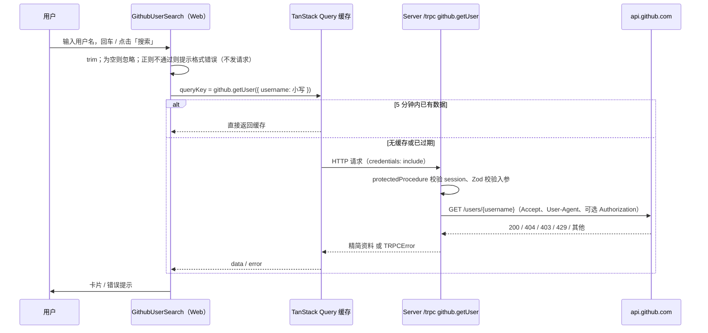

# R03 GitHub 用户查询 - 技术设计

> 技术参考：[AGENTS.md](../../AGENTS.md)

## 技术约定

- API 使用 tRPC v11 + `@trpc/tanstack-react-query` + TanStack Query v5；Web UI 使用 shadcn/ui（`base-lyra`）+ Tailwind CSS v4（AGENTS.md「技术栈」）
- 新增 API：在 `packages/api/src/routers/` 下建子 router 并合并进 `appRouter`；需要登录的接口用 `protectedProcedure`，入参用 Zod 校验（AGENTS.md「开发约定」）
- 共享包不读取环境变量，只暴露工厂函数和配置类型；唯一组装点是 `apps/server/src/services.ts`，新增共享服务沿用这个模式（AGENTS.md「架构要点 / 依赖注入（工厂模式）」）
- tRPC 的 `Context` 必须用 `type`，不能改成 `interface`（AGENTS.md「开发约定 / Lint 规则的取舍」）
- 前端只从 `@zyk-dyna-admin/api` 导入类型（`AppRouter`），运行时通过 HTTP 调用后端（AGENTS.md「架构要点 / 依赖关系」）
- 环境变量用 Varlock：在 `.env.schema` 声明，执行 `pnpm run env:generate` 重新生成 `src/env.ts`（不手改）；应用代码用生成的 `ENV` 读取；新增环境变量同步更新 `turbo.json` 的 `globalEnv`；密钥类变量不写默认值（AGENTS.md「架构要点 / 环境变量（Varlock）」）
- 共享 UI 组件用 `npx shadcn@latest add <组件> -c packages/ui` 添加，从 `@zyk-dyna-admin/ui/components/<name>` 导入；`packages/ui` 生成代码不手改；业务组件放 `apps/web/src/components`（AGENTS.md「开发约定」）
- `apps/web/src/utils/trpc.ts` 的 QueryClient 有全局错误 toast（AGENTS.md「目录结构」）
- `noUnnecessaryConditions` 关闭，保留 TanStack Query 的加载判断（AGENTS.md「开发约定 / Lint 规则的取舍」）
- 外链 `target="_blank"` 要带 `rel="noopener"`；正则用顶层字面量；不用魔法数字，抽成命名常量；不保留 `console.log`（AGENTS.md「Ultracite Code Standards」）
- `apps/web` 是新版 Next.js 16，写代码前先查 `apps/web/node_modules/next/dist/docs/`（apps/web/AGENTS.md）

## 方案概述

1. **GitHub 客户端工厂**（`packages/api/src/lib/github.ts`）：`createGithubClient(config: GithubConfig, fetchImpl = fetch)`，`GithubConfig = { GITHUB_TOKEN?: string }`。`getUser(username)` 请求 `https://api.github.com/users/{username}`，带 `Accept: application/vnd.github+json`、`User-Agent: zyk-dyna-admin`（技术参考未规定 UA 取值，暂按项目名）、`X-GitHub-Api-Version: 2022-11-28`（技术参考未规定，暂按 GitHub 文档推荐），配置了 Token 时加 `Authorization: Bearer <token>`；超时 10 秒（`AbortSignal.timeout`，技术参考未规定，暂按 10 秒）。成功时只挑出需要的字段返回；失败时抛出带 `kind` 的 `GithubApiError`（`not_found` / `rate_limited` / `upstream`）。注入 `fetchImpl` 是为了测试时不连真实 GitHub。
2. **组装与注入**：`apps/server/src/services.ts` 中 `export const github = createGithubClient(ENV)`；`packages/api/src/context.ts` 的 `Context` 增加 `github: GithubClient`；`apps/server/src/context.ts` 的 `createContext` 返回 `{ db, session, github }`。
3. **tRPC 子路由**（`packages/api/src/routers/github.ts`）：`githubRouter = router({ getUser: protectedProcedure.input(z.object({ username: githubUsernameSchema })).query(...) })`，捕获 `GithubApiError` 映射为 `TRPCError`：`not_found` → `NOT_FOUND`、`rate_limited` → `TOO_MANY_REQUESTS`、`upstream` → `INTERNAL_SERVER_ERROR`。在 `routers/index.ts` 合并为 `github: githubRouter`。
4. **环境变量**：`apps/server/.env.schema` 增加 `GITHUB_TOKEN`，用 `# @optional`（继承文件头的 `@defaultSensitive=true`，不写默认值）；执行 `pnpm run env:generate`；`turbo.json` 的 `globalEnv` 加入 `GITHUB_TOKEN`。
5. **前端页面**：`/dashboard/page.tsx` 保留服务端 session 校验，页面内容替换为 `GithubUserSearch`。`GithubUserSearch` 用 TanStack Form 做搜索表单，字段的 `onSubmit` 校验器复用 `parseGithubUsernameInput()`（与后端同一正则，不再单独写 Zod schema；空输入直接忽略，格式不合法显示「GitHub 用户名格式不正确」并清掉上一次结果）；校验通过后把 trim + 小写后的用户名存到 state，驱动 `useQuery(trpc.github.getUser.queryOptions(username === null ? skipToken : { username }, { staleTime: 5 分钟, retry: false, meta: { skipGlobalErrorToast: true } }))`（用 `skipToken` 代替 `enabled: username !== null`，避免为禁用状态构造假的入参，效果相同）。同一用户名上次查询失败时再次提交会调用 `refetch()` 重新请求（错误结果不缓存）。根据 `isFetching` 显示骨架屏并禁用「搜索」按钮，根据 `error.data?.code` 经 `getGithubSearchErrorMessage()`（`apps/web/src/lib/github-search-errors.ts`）显示中文错误，成功时渲染 `GithubUserCard`。
6. **全局错误 toast**：`apps/web/src/utils/trpc.ts` 的 `QueryCache.onError` 在 `query.meta?.skipGlobalErrorToast` 为 true 时跳过，避免页面内错误提示和 toast 重复。
7. **UI 组件**：用 `npx shadcn@latest add avatar -c packages/ui` 添加 `Avatar`；卡片使用已有的 `Card`、`Input`、`Button`、`Label`、`Skeleton`。
8. **原有示例**：`dashboard.tsx` 中调用 `privateData` 的示例展示被搜索组件替换；`privateData` 路由本身保留不动。

## 涉及模块 / 文件

| 文件 | 改动 |
| --- | --- |
| `packages/api/src/lib/github.ts`（新建） | `GithubConfig`、`GithubUserProfile`、`GithubApiError`、`createGithubClient`、`GithubClient` 类型 |
| `packages/api/src/lib/github-username.ts`（新建） | `GITHUB_USERNAME_PATTERN` 顶层正则与 `githubUsernameSchema` |
| `packages/api/src/routers/github.ts`（新建） | `githubRouter`（`getUser`） |
| `packages/api/src/routers/index.ts` | 合并 `github: githubRouter` |
| `packages/api/src/context.ts` | `Context` 增加 `github: GithubClient`（保持 `type`） |
| `apps/server/src/services.ts` | `export const github = createGithubClient(ENV)` |
| `apps/server/src/context.ts` | 注入 `github` |
| `apps/server/.env.schema` | 新增可选敏感变量 `GITHUB_TOKEN` |
| `apps/server/src/env.ts` | `pnpm run env:generate` 重新生成（不手改） |
| `turbo.json` | `globalEnv` 增加 `GITHUB_TOKEN` |
| `packages/ui/src/components/avatar.tsx`（新建） | shadcn CLI 生成 |
| `apps/web/src/lib/github-username.ts`（新建） | 前端校验用的同一正则（前端不能运行时导入 api 包） |
| `apps/web/src/lib/github-profile-format.ts`（新建） | `formatJoinedDate()`、`normalizeBlogUrl()` |
| `apps/web/src/lib/github-search-errors.ts`（新建） | `getGithubSearchErrorMessage()`：TRPCError code → 中文提示 |
| `apps/web/src/components/github-user-search.tsx`（新建） | 搜索表单、查询、错误与加载状态 |
| `apps/web/src/components/github-user-card.tsx`（新建） | 资料卡片与骨架屏 |
| `apps/web/src/app/dashboard/page.tsx`、`apps/web/src/app/dashboard/dashboard.tsx` | 渲染搜索组件 |
| `apps/web/src/utils/trpc.ts` | 全局错误 toast 支持 `meta.skipGlobalErrorToast` |
| `packages/api/src/**/*.test.ts`、`apps/web/src/lib/*.test.ts`、`apps/web/e2e/github-search.spec.ts` | 测试 |

## 数据模型

无数据库改动。服务端返回类型 `GithubUserProfile`：

| 字段 | 类型 | 来源 | 说明 |
| --- | --- | --- | --- |
| `login` | `string` | `login` | |
| `name` | `string \| null` | `name` | 空字符串统一转 `null` |
| `avatarUrl` | `string` | `avatar_url` | |
| `htmlUrl` | `string` | `html_url` | |
| `bio` | `string \| null` | `bio` | 同上 |
| `company` | `string \| null` | `company` | 同上 |
| `location` | `string \| null` | `location` | 同上 |
| `blog` | `string \| null` | `blog` | GitHub 无博客时返回 `""`，统一转 `null` |
| `publicRepos` | `number` | `public_repos` | |
| `followers` | `number` | `followers` | |
| `following` | `number` | `following` | |
| `createdAt` | `string` | `created_at` | ISO 8601 原样返回，前端格式化 |

GitHub 响应先用 Zod schema 解析（只声明上面用到的字段），解析失败按 `upstream` 处理。

## 接口设计

**tRPC：`github.getUser`**（query，`protectedProcedure`）

- 入参：`{ username: string }`，`githubUsernameSchema = z.string().trim().regex(GITHUB_USERNAME_PATTERN)`，`GITHUB_USERNAME_PATTERN = /^[a-z\d](?:[a-z\d]|-(?=[a-z\d])){0,38}$/i`（1–39 位，字母数字或中间单个连字符，不能以 `-` 开头或结尾）
- 出参：`GithubUserProfile`
- 错误：

| 场景 | TRPCError code | 前端文案 |
| --- | --- | --- |
| 未登录 | `UNAUTHORIZED` | （页面已由服务端重定向，不会出现） |
| 入参格式不合法 | `BAD_REQUEST` | GitHub 用户名格式不正确 |
| GitHub 404 | `NOT_FOUND` | 未找到该 GitHub 用户 |
| GitHub 403 / 429 | `TOO_MANY_REQUESTS` | 请求过于频繁，请稍后再试 |
| 其他状态码、网络错误、超时、响应解析失败 | `INTERNAL_SERVER_ERROR` | 查询失败，请稍后再试 |

TRPCError 的 `message` 只写通用英文描述，不带 Token、不带 GitHub 原始响应。

**前端格式化**：

- `parseGithubUsernameInput(input)`：返回 `{ status: "empty" }` / `{ status: "invalid" }` / `{ status: "valid", username }`（trim 后小写）；格式错误文案常量 `GITHUB_USERNAME_INVALID_MESSAGE` 同文件导出。
- `formatJoinedDate(iso)`：取 UTC 日期，输出 `YYYY-MM-DD`（技术参考未规定时区，暂按 UTC，与 GitHub 返回值一致）；无法解析时返回 `null`，卡片不渲染该行。
- `normalizeBlogUrl(blog)`：返回可用作 `href` 的地址或 `null`。没有协议时补 `https://`（`host:port` 视为无协议，`//host` 补 `https:`）；只接受 `http:` / `https:`，其他协议（如 `javascript:`）或无法解析时返回 `null`，卡片只显示文本、不渲染成链接。

## 关键流程

## 异常与边界情况

- 空输入、只有空格：不设置查询参数，不发请求，也不显示错误。
- 格式不合法：`-abc`、`abc-`、`a--b`、40 位字符串、包含 `_` 或中文，前端提示「GitHub 用户名格式不正确」，不发请求；服务端 Zod 再校验一次兜底。
- 大小写：输入 trim 后转小写作为查询参数和缓存键，`Torvalds` 与 `torvalds` 共用缓存（已确认）。
- 缓存：`staleTime` 5 分钟；`gcTime` 保持默认 5 分钟（从查询不再被观察时开始计时），切换搜索其他用户后再搜回来，5 分钟内仍命中。错误结果不缓存（下次搜索重新请求）。
- 重试：`retry: false`，避免 404 / 429 时 TanStack Query 默认重试 3 次加重频率限制。
- 空字段：`name` 为空显示 `login`；`bio`、`company`、`location`、`blog` 为 `null` 时整行不渲染；数字字段为 0 时正常显示 `0`。
- 长文本：简介、博客地址使用 `wrap-anywhere`（overflow-wrap: anywhere）/ `min-w-0`，375px 下不撑出横向滚动（`break-words` 不会降低 min-content 宽度，在布局的 grid 自动列里超长无空格文本仍会撑宽页面）。
- 头像加载失败：`AvatarFallback` 显示 `login` 首字母；`alt` 为「<login> 的头像」。
- 403 的含义：GitHub 的 403 也可能是其他拒绝原因，PRD 明确要求 403 一律按频率超限提示，照此实现。
- 加载中再次提交：按钮在 `isFetching` 时禁用。

## 风险与取舍

- **新增 Avatar 组件**：通过 shadcn CLI 生成到 `packages/ui`，`base-lyra` 风格基于已安装的 `@base-ui/react`，预计不新增 npm 依赖；如果 CLI 提示要安装新依赖，需要按高风险改动先确认。
- **正则前后端各一份**：前端不能运行时导入 `@zyk-dyna-admin/api`，所以 `GITHUB_USERNAME_PATTERN` 在 `packages/api` 和 `apps/web` 各写一份，用单元测试分别覆盖同一组用例保证一致。
- **Context 增加 `github`**：`Context` 类型变化会影响所有 router 的测试构造，测试里用假的 `GithubClient` 注入。
- **只做前端缓存**：多个用户或多个标签页查询同一个人仍会各自请求 GitHub；未配置 `GITHUB_TOKEN` 时匿名额度为每 IP 每小时 60 次，可能较快触发 403 / 429。
- **测试框架**：沿用 R01 已确认的 Vitest + Playwright；E2E 同样使用测试库 `zyk_dyna_admin_test`。
