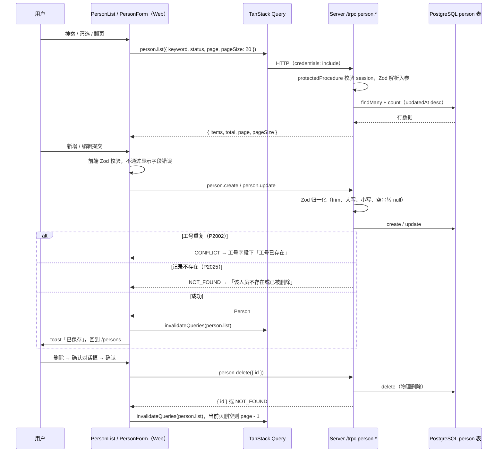

# R04 人员管理（入库、修改、删除） - 技术设计

> 技术参考：[AGENTS.md](../../AGENTS.md)

## 技术约定

- 数据库为 PostgreSQL + Prisma 7（`prisma-client` generator、ESM 输出、`@prisma/adapter-pg`）；API 为 tRPC v11 + `@trpc/tanstack-react-query` + TanStack Query v5；表单 / 校验为 TanStack Form + Zod 4；Web UI 为 shadcn/ui（`base-lyra`，基于 `@base-ui/react`）+ Tailwind CSS v4（AGENTS.md「技术栈」）
- 新增数据表：在 `packages/db/prisma/schema/` 下新建 `.prisma` 文件（多文件 schema），执行 `db:generate`，再 `db:migrate`；不手改 `auth.prisma`；`packages/db/prisma/generated/` 不手改（AGENTS.md「开发约定」）
- `prisma migrate dev` 是交互式命令，非交互环境必须用 `--name <迁移名>`（AGENTS.md「经验与踩坑」R01）
- 新增 API：在 `packages/api/src/routers/` 下建子 router 并合并进 `appRouter`；需要登录的接口用 `protectedProcedure`，入参用 Zod 校验（AGENTS.md「开发约定」）
- tRPC 的 `Context` 必须用 `type`（本需求不改 `Context`，通过已有的 `ctx.db` 访问数据库）（AGENTS.md「开发约定 / Lint 规则的取舍」、「架构要点 / 依赖注入（工厂模式）」）
- 前端只从 `@zyk-dyna-admin/api` 导入类型（`AppRouter`），运行时通过 HTTP 调用后端（AGENTS.md「架构要点 / 依赖关系」）
- 需要登录的页面是 Server Component，用 `authClient.getSession` 并通过 `fetchOptions.headers: await headers()` 转发请求头；网络异常要 try / catch 按未登录处理，`redirect` 放在 try 之外（AGENTS.md「架构要点 / 认证与跨端」、「经验与踩坑」R02）
- `apps/web/src/utils/trpc.ts` 的 QueryClient 有全局错误 toast，页面内自行展示错误的查询用 `meta.skipGlobalErrorToast` 跳过（AGENTS.md「目录结构」，R03 已实现）
- 共享 UI 组件用 `npx shadcn@latest add <组件> -c packages/ui` 添加，从 `@zyk-dyna-admin/ui/components/<name>` 导入；`packages/ui` 生成代码不手改；业务组件放 `apps/web/src/components`（AGENTS.md「开发约定」）
- `noUnnecessaryConditions` 关闭，保留 TanStack Query 的加载判断；`noJsxPropsBind` 关闭（React Compiler）（AGENTS.md「开发约定 / Lint 规则的取舍」）
- 正则用顶层字面量；不用魔法数字，抽成命名常量；不保留 `console.log`；表单输入有 `<label>`（AGENTS.md「Ultracite Code Standards」）
- 测试：单元测试与被测文件同目录，命名 `*.test.ts`；E2E 放 `apps/web/e2e/*.spec.ts`，只连测试库 `zyk_dyna_admin_test`，`global-setup` 先 `db:migrate:deploy` 再清空业务表；E2E 复用 `apps/web/e2e/support/page-helpers.ts`（`tabUntilFocused` / `pressUntilFocused` / `NARROW_VIEWPORT` / `getScrollWidth`）（AGENTS.md「开发约定 / 测试」、「经验与踩坑」R02）
- `apps/web` 是新版 Next.js 16（`typedRoutes`、动态路由 `params` 为 Promise），写代码前先查 `apps/web/node_modules/next/dist/docs/`（apps/web/AGENTS.md）

## 方案概述

1. **数据表**：新建 `packages/db/prisma/schema/person.prisma`（模型 `Person`、枚举 `PersonStatus`，见「数据模型」）；执行 `pnpm run db:generate`，再执行 `pnpm run db:migrate -- --name add_person`（若参数没有透传给 prisma，改用 `pnpm --dir packages/db run db:migrate --name add_person`），生成 `packages/db/prisma/migrations/<时间戳>_add_person/`。`packages/db/src/index.ts` 追加导出：`PersonStatus`（值 + 类型）、`PrismaClientKnownRequestError`（值 + 类型，用于识别 `P2002` / `P2025`），以及只导出类型的 `Prisma` 命名空间和 `Person`。（实现时调整：Biome `noBarrelFile` 禁止 `export { X } from` 形式的值重导出，`noExportedImports` 又禁止导入后直接导出，所以值用 `export const` 重新声明；`Prisma` 命名空间只作类型导出，后文写 `Prisma.PrismaClientKnownRequestError` 的地方一律改用 `@zyk-dyna-admin/db` 导出的 `PrismaClientKnownRequestError`。）
2. **入参 schema 与归一化**（`packages/api/src/lib/person-input.ts`）：用 Zod 定义各字段 schema，transform 中完成 trim、工号转大写、邮箱转小写、选填字段空字符串转 `null`；导出 `personInputSchema`、`personListInputSchema`、`personIdSchema` 和正则常量。服务端只以这里解析后的数据写库，不信任前端。（实现时补充：`personIdSchema` 是 id 字符串本身；另导出 `personIdInputSchema = { id }`（`getById` / `delete` 入参）、`personUpdateInputSchema = personInputSchema.extend({ id })`（`update` 入参）、`PERSON_STATUSES` / `personStatusSchema` 与输出类型 `PersonInput` 等，供路由直接使用。）
3. **tRPC 子路由**（`packages/api/src/routers/person.ts`）：`personRouter = router({ list, getById, create, update, delete })`，全部 `protectedProcedure`，通过 `ctx.db.person` 读写。Prisma `P2002` → `TRPCError` `CONFLICT`，`P2025` 或查不到 → `NOT_FOUND`（判断函数 `isPrismaErrorCode(error, code)` 放在 `packages/api/src/lib/prisma-errors.ts`）。在 `routers/index.ts` 合并为 `person: personRouter`。（实现时补充：已在测试库实测 Prisma 7 + `@prisma/adapter-pg` 的 `contains` 生成 `ILIKE ('%' || $1 || '%')`，**不转义** `%` / `_` / `\`，所以新增 `packages/api/src/lib/prisma-like.ts` 的 `escapeLikePattern()`，`list` 先转义搜索词再传给 `contains`；另导出 `PRISMA_UNIQUE_CONSTRAINT_FAILED` / `PRISMA_RECORD_NOT_FOUND` 常量。）
4. **UI 组件**：`npx shadcn@latest add table alert-dialog select -c packages/ui`。翻页用已有 `Button`（上一页 / 下一页按钮驱动组件状态），不添加 `pagination`（它的 `PaginationLink` 渲染为 `<a>` 链接，适合 URL 分页；本期页码不进 URL）。空状态用已有的 `empty`，备注用已有的 `textarea`。
5. **前端工具函数**（`apps/web/src/lib/`）：
   - `person-validation.ts`：与后端同一组正则和长度常量、TanStack Form 字段校验用的 Zod schema（中文错误文案）、`PERSON_STATUS_OPTIONS`（`ACTIVE` → 在职、`INACTIVE` → 离职）、`toPersonInput(values)`（提交前 trim / 空串转 `null`，服务端会再做一次）。前端不能运行时导入 `@zyk-dyna-admin/api`，所以正则前后端各写一份。
   - `person-format.ts`：`formatPersonDateTime(iso)` → `YYYY-MM-DD HH:mm`、`displayPersonValue(value)` → 空值返回 `-`、`getTotalPages(total, pageSize)`。
   - `person-errors.ts`：TRPCError code → 中文提示（`CONFLICT` → 工号已存在、`NOT_FOUND` → 该人员不存在或已被删除，其余按场景兜底）。
   - `server-session.ts`：`getServerSessionUser()`，Server Component 转发 `headers()` 调 `authClient.getSession`，网络异常 try / catch 返回 `null`。
   - （实现时补充：`person-validation.ts` 另导出 `personFormSchema`（整体解析结果与服务端 `personInputSchema` 一致，供提交前整体校验和前后端一致性测试）、`PERSON_STATUS_LABELS`、`PERSON_LIST_PAGE_SIZE = 20`、`EMPTY_PERSON_FORM_VALUES`（状态默认 `ACTIVE`）、`toPersonFormValues(person)`（编辑回填，`null` → 空串）；`toPersonInput()` 除 trim / 空串转 `null` 外也把工号转大写、邮箱转小写，结果与服务端归一化一致；`toPersonInput()` 返回类型用 `import type { PersonInput }` 与服务端对齐（只导入类型）。`person-errors.ts` 导出 `getPersonSaveError(code)`（返回 `employeeNoConflict` / `notFound` / `unknown` 三类及文案）、`getPersonDeleteErrorMessage(code)`、`getPersonLoadErrorMessage(code)`、`isPersonNotFound(code)`。邮箱超过 254 个字符的前端文案为「邮箱不能超过 254 个字符」（需求未规定该文案）。）
6. **页面**（`apps/web/src/app/persons/`）：`page.tsx`、`new/page.tsx`、`[id]/edit/page.tsx` 都是 Server Component，先 `getServerSessionUser()`，为空时在 try 之外 `redirect("/login")`，再渲染客户端组件。在每个 page 里校验，不放在 layout（layout 在客户端导航时不会重新执行）。
7. **客户端组件**（`apps/web/src/components/`）：
   - `person-list.tsx`：搜索表单（`<Label>` + 输入框 + 「搜索」按钮，`<form>` 提交支持回车）、状态 `Select`（全部 / 在职 / 离职）、`Table`（外层容器 `overflow-x-auto`，表格自身横向滚动）、翻页条、空状态；`useQuery(trpc.person.list.queryOptions({ keyword, status, page, pageSize: 20 }, { placeholderData: keepPreviousData, meta: { skipGlobalErrorToast: true } }))`，加载失败在页面内显示「加载失败，请稍后再试」。（实现时补充：加载失败时另提供「重试」按钮；搜索框 `maxLength` 用 `person-validation.ts` 新增的 `PERSON_KEYWORD_MAX_LENGTH = 100`（与服务端一致），提交时 trim；「第 X / Y 页」的 X 取当前显示数据的 `page`（翻页请求返回前仍显示上一页的页码，与表格内容一致）；翻页请求进行中（`isPlaceholderData`）和首末页时禁用翻页按钮，按钮用 `@base-ui/react` 的 `focusableWhenDisabled`（渲染 `aria-disabled`，禁用后焦点不丢失，键盘连续翻页可用）；「编辑」链接带 `sr-only` 的「姓名（工号）」，可访问名称为「编辑 姓名（工号）」；页码越界回退在 `useEffect` 里执行，只在非占位数据时判断；「删除」按钮作为 `person-delete-dialog.tsx` 的触发按钮在 6.5 接入操作列。）
   - `person-delete-dialog.tsx`：`AlertDialog` 二次确认，确认后调 `person.delete`；成功 toast「已删除」，`NOT_FOUND` toast「该人员不存在或已被删除」，两种情况都让 `person.list` 失效。（实现时补充：组件接收 `person: { id, name, employeeNo }`，自带触发按钮「删除」（`variant="destructive"`、`sr-only` 的「姓名（工号）」，可访问名称为「删除 姓名（工号）」），放在列表操作列「编辑」右侧；对话框标题「删除人员」，确认按钮「确定删除」，请求中显示「删除中…」并用 `focusableWhenDisabled` 禁用（焦点不跑出对话框），同时禁用「取消」并忽略 Esc 等关闭请求，避免用户误以为已取消；成功或 `NOT_FOUND` 时关闭对话框并让 `person.list` 失效；其他错误 toast「删除失败，请稍后再试」，对话框保留以便重试或取消。）
   - `person-form.tsx`：新增 / 编辑共用的 TanStack Form 表单（`mode: "create" | "edit"`、`defaultValues`、`onSubmit` 回调），字段级 `onChange` 校验 + 提交前整体校验，复用 `field-messages.tsx` 的 `FieldMessages` / `getFieldA11yProps` / `toMessages`；服务端 `CONFLICT` 显示在工号字段下；提交中按钮显示 `Loader2` 并禁用；「取消」按钮回到 `/persons`。
   - `person-create.tsx`：`useMutation(trpc.person.create.mutationOptions())`，成功后 `invalidateQueries(trpc.person.list.pathFilter())`、toast「已保存」、`router.push("/persons")`。
   - （实现时调整：`person-form.tsx` 不需要 `mode` 参数（新增和编辑的差别只在父组件调用的接口），改为 `defaultValues` + `onSubmit(input: PersonInput) => Promise<PersonFormSubmitResult>`；父组件返回 `{ status: "saved" }`（按钮保持禁用直到跳转完成）、`{ status: "employeeNoConflict", message }`（表单把错误显示在工号字段下，修改工号后清除）或 `{ status: "failed" }`（父组件已自行 toast 或切换为不存在提示）。状态 `Select` 的 `SelectTrigger` 设置 `id="status"`，由 `<Label htmlFor>` 关联；必填字段标签带 `*`（`aria-hidden`）并设置 `aria-required`。从 mutation 错误里取 tRPC 错误码的 `getTrpcErrorCode(error)` 新建在 `apps/web/src/lib/trpc-errors.ts`（`isTRPCClientError<AppRouter>`，非 tRPC 错误或网络错误返回 `undefined`），供 6.2 / 6.3 / 6.5 共用，附单元测试 `trpc-errors.test.ts`。）
   - `person-edit.tsx`：`useQuery(trpc.person.getById.queryOptions({ id }, { retry: false, meta: { skipGlobalErrorToast: true } }))` 回填；`NOT_FOUND` 时显示「该人员不存在或已被删除」和「返回列表」链接；提交用 `person.update`，成功后让 `person.list` 和该 `getById` 失效、toast「已保存」、回列表；提交时 `NOT_FOUND` 同样切换到不存在提示。（实现时补充：`getById` 返回 `BAD_REQUEST`（如超过 64 个字符的随意 id）同样不可能查到人员，也按不存在处理；其他加载错误且没有已加载数据时，页面内显示「加载失败，请稍后再试」+「重试」+「返回列表」，后台重新请求失败但已有数据时继续显示表单；保存成功后先 `setQueryData` 写入最新数据，再以 `refetchType: "none"` 让该 `getById` 失效，避免即将离开的编辑页再发一次请求；加载中的骨架屏为 `role="status"`、`aria-label="正在加载"`。）
8. **顶部导航**：`apps/web/src/components/header.tsx` 的 `links` 增加 `{ label: "人员管理", to: "/persons" }`。（实现时补充：375px 下实测新增链接后页面不出现横向滚动，但 `nav` 被挤压时「人员管理」会一字一行换行，所以 `nav` 加 `shrink-0 whitespace-nowrap`、间距改为 `gap-3 sm:gap-4`，由右侧用户菜单按钮截断名字让出空间。另：新增 `typedRoutes` 路由后需执行 `next typegen`（或 `next dev` / `next build`）重新生成路由类型，否则 `tsc` 报 `/persons` 不是合法 `href`。6.1 阶段页面只渲染标题，编辑页把 `id` 写在 `main` 的 `data-person-id` 上，客户端组件在 6.2–6.4 挂载。）
9. **E2E 数据准备**：`apps/web/e2e/support/persons.ts` 提供 `resetPersons()`（`TRUNCATE person`）和 `seedPersons(rows)`（用 `pg` 直接插入，翻页用例批量造 21+ 条、可指定 `updatedAt`）。`global-setup` 现有逻辑已清空 public 下除 `_prisma_migrations` 外的所有表，`person` 表自动包含在内，只需在用例里确认。

## 涉及模块 / 文件

| 文件 | 改动 |
| --- | --- |
| `packages/db/prisma/schema/person.prisma`（新建） | `Person` 模型、`PersonStatus` 枚举 |
| `packages/db/prisma/migrations/<时间戳>_add_person/`（生成） | `prisma migrate dev --name add_person` 生成，不手改 |
| `packages/db/src/index.ts` | 追加导出 `PersonStatus`、`PrismaClientKnownRequestError`（值 + 类型），类型导出 `Prisma`、`Person` |
| `packages/api/src/lib/person-input.ts`（新建） | 正则 / 长度常量、字段 schema、`personInputSchema`、`personListInputSchema`、`personIdSchema` |
| `packages/api/src/lib/prisma-errors.ts`（新建） | `isPrismaErrorCode(error, code)` |
| `packages/api/src/lib/prisma-like.ts`（新建） | `escapeLikePattern()`：转义 LIKE 通配符 `%` / `_` / `\` |
| `packages/api/src/routers/person.ts`（新建） | `personRouter`（`list`、`getById`、`create`、`update`、`delete`） |
| `packages/api/src/routers/index.ts` | 合并 `person: personRouter` |
| `packages/ui/src/components/{table,alert-dialog,select}.tsx`（新建） | shadcn CLI 生成，不手改 |
| `apps/web/src/lib/person-validation.ts`（新建） | 前端校验（与后端同一组规则）、状态选项、`toPersonInput()` |
| `apps/web/src/lib/person-format.ts`（新建） | `formatPersonDateTime()`、`displayPersonValue()`、`getTotalPages()` |
| `apps/web/src/lib/person-errors.ts`（新建） | 错误码 → 中文提示 |
| `apps/web/src/lib/trpc-errors.ts`（新建） | `getTrpcErrorCode(error)`：从 tRPC 客户端错误取错误码 |
| `apps/web/src/lib/server-session.ts`（新建） | `getServerSessionUser()` |
| `apps/web/src/app/persons/page.tsx`（新建） | 列表页 |
| `apps/web/src/app/persons/new/page.tsx`（新建） | 新增页 |
| `apps/web/src/app/persons/[id]/edit/page.tsx`（新建） | 编辑页（`params: Promise<{ id: string }>`） |
| `apps/web/src/components/person-list.tsx`、`person-delete-dialog.tsx`、`person-form.tsx`、`person-create.tsx`、`person-edit.tsx`（新建） | 业务组件 |
| `apps/web/src/components/header.tsx` | 导航增加「人员管理」 |
| `packages/api/src/lib/person-input.test.ts`、`packages/api/src/routers/person.test.ts` | 单元 / 路由测试 |
| `apps/web/src/lib/person-validation.test.ts`、`person-format.test.ts`、`person-errors.test.ts`、`trpc-errors.test.ts` | 前端单元测试 |
| `apps/web/e2e/support/persons.ts`（新建）、`apps/web/e2e/persons.spec.ts`（新建） | E2E 数据准备与用例 |

## 数据模型

`packages/db/prisma/schema/person.prisma`：

```prisma
enum PersonStatus {
  ACTIVE
  INACTIVE
}

model Person {
  id         String       @id @default(cuid())
  name       String       @db.VarChar(50)
  employeeNo String       @unique @db.VarChar(32)
  phone      String?      @db.VarChar(11)
  email      String?      @db.VarChar(254)
  department String?      @db.VarChar(50)
  position   String?      @db.VarChar(50)
  status     PersonStatus @default(ACTIVE)
  remark     String?      @db.VarChar(500)
  createdAt  DateTime     @default(now())
  updatedAt  DateTime     @updatedAt

  @@index([updatedAt])
  @@map("person")
}
```

- 字段名和表名映射：技术参考只规定 `@@map("person")`，列名暂按 Prisma 字段名（camelCase，与 `auth.prisma` 一致）。
- 长度约束：技术参考未规定列类型，暂按 `VarChar(n)` 与业务规则一致，作为最后一道防线；PostgreSQL 的 `varchar(n)` 按字符计，Zod 的 `.max()` 按 UTF-16 码元计（不小于字符数），Zod 通过的值一定能写入。邮箱长度需求未规定，暂按 254（RFC 5321 上限）。
- `id` 的 `cuid()` 和 `updatedAt` 的 `@updatedAt` 由 Prisma Client 生成，数据库列没有默认值；E2E 用 `pg` 直接插入时要自己提供 `id` 和 `updatedAt`。
- 工号唯一：服务端统一转大写后写入，`@unique` 就等价于不区分大小写的唯一。

## 接口设计

**字段规则**（前后端同一组常量，后端在 `packages/api/src/lib/person-input.ts`，前端在 `apps/web/src/lib/person-validation.ts`）：

| 字段 | 规则（先 trim） | 归一化 | 前端错误文案 |
| --- | --- | --- | --- |
| `name` | 必填，1–50 | trim | 请输入姓名 / 姓名不能超过 50 个字符 |
| `employeeNo` | 必填，`EMPLOYEE_NO_PATTERN = /^[A-Za-z0-9-]{2,32}$/` | trim → 大写 | 请输入工号 / 工号为 2–32 位字母、数字或连字符 |
| `phone` | 选填，`PHONE_PATTERN = /^1[3-9]\d{9}$/` | trim，空 → `null` | 请输入正确的 11 位手机号 |
| `email` | 选填，`z.email()`，最多 254 | trim → 小写，空 → `null` | 邮箱格式不正确 |
| `department` | 选填，最多 50 | trim，空 → `null` | 部门不能超过 50 个字符 |
| `position` | 选填，最多 50 | trim，空 → `null` | 职位不能超过 50 个字符 |
| `status` | 必填，`ACTIVE` / `INACTIVE` | — | 请选择状态 |
| `remark` | 选填，最多 500 | trim，空 → `null` | 备注不能超过 500 个字符 |

后端 schema 接受 `string | null | undefined`（选填字段），统一输出 `string | null`；错误 message 用英文通用描述，前端不展示服务端原文。

**tRPC：`person.*`**（全部 `protectedProcedure`）

| 过程 | 类型 | 入参 | 出参 |
| --- | --- | --- | --- |
| `person.list` | query | `{ keyword?: string（trim，最多 100，技术参考未规定上限，暂按 100；空串视为无条件）, status?: "ACTIVE" \| "INACTIVE", page: int ≥ 1（默认 1）, pageSize: int 1–100（默认 20） }` | `{ items: Person[], total: number, page: number, pageSize: number }` |
| `person.getById` | query | `{ id: string（trim，1–64） }` | `Person` |
| `person.create` | mutation | `personInputSchema` | `Person` |
| `person.update` | mutation | `{ id, ...personInputSchema }`（整体替换所有字段） | `Person` |
| `person.delete` | mutation | `{ id }` | `{ id: string }` |

- `list`：`where = { status?, OR: [{ name: { contains, mode: "insensitive" } }, { employeeNo: { contains, mode: "insensitive" } }] }`；`orderBy: [{ updatedAt: "desc" }, { id: "desc" }]`（`id` 作为并列时的稳定排序，技术参考未规定，暂按此）；`skip = (page - 1) * pageSize`、`take = pageSize`；`findMany` 与 `count` 用 `Promise.all` 并行（技术参考未规定是否用事务，暂按并行查询，极端并发下总数可能与当页有一瞬不一致，可接受）。页码超出范围时返回空 `items` 和真实 `total`，由前端回退。
- tRPC 未配置 transformer，`createdAt` / `updatedAt` 在客户端是 ISO 字符串（tRPC 推断出的类型也是 `string`）。

**错误映射**：

| 场景 | TRPCError code | 前端文案 |
| --- | --- | --- |
| 未登录 | `UNAUTHORIZED` | （页面已由服务端重定向） |
| 入参不合法 | `BAD_REQUEST` | 前端已拦截；兜底 toast「保存失败，请稍后再试」 |
| 工号冲突（`P2002`） | `CONFLICT` | 工号字段下「工号已存在」 |
| 记录不存在（`getById` 查不到、`update` / `delete` 的 `P2025`） | `NOT_FOUND` | 该人员不存在或已被删除 |
| 其他错误 | `INTERNAL_SERVER_ERROR` | 保存失败 / 删除失败 / 加载失败，请稍后再试 |

**前端格式化**：

- `formatPersonDateTime(iso)`：按浏览器本地时区格式化为 `YYYY-MM-DD HH:mm`（技术参考未规定时区，暂按本地时区；列表是客户端渲染，不存在 SSR 水合不一致），无法解析返回 `-`。
- `displayPersonValue(value)`：`null` / `undefined` / 空串返回 `-`。
- `getTotalPages(total, pageSize)`：`Math.max(1, Math.ceil(total / pageSize))`，用于「第 X / Y 页，共 N 条」。

## 关键流程



## 异常与边界情况

- 只有空格的姓名 / 工号：trim 后为空，视为未填。选填字段只有空格：trim 后为空，存 `null`。
- 工号大小写：`a001` 存为 `A001`；用 `A001` 或 `a001` 再新增都冲突；编辑自己时工号不变或只改大小写不算冲突（同一条记录）。
- 邮箱不唯一：多人可以用同一邮箱。
- 搜索词：trim 后为空视为不过滤；`mode: "insensitive"` 对姓名和工号都生效。搜索词含 `%` / `_` 时应按字面量匹配，已验证 Prisma 的 `contains` 不转义通配符，由 `escapeLikePattern()` 手动转义（只转义一次）。
- 翻页回退：列表返回 `items` 为空、`total > 0` 且 `page > 1` 时，把页码改为 `getTotalPages(total, 20)`，覆盖「当前页删空回到上一页」和「别人删除后页码越界」两种情况。
- 切换搜索词 / 状态：页码重置为 1；翻页时用 `keepPreviousData` 保留上一页数据，避免表格闪烁；加载中禁用翻页按钮。
- 空状态区分：`total === 0` 且没有搜索词和状态筛选时显示「暂无人员」+「新增人员」；否则显示「没有找到匹配的人员」。
- 编辑页 id 不存在（包括 `/persons/xxx/edit` 这类随意的 id）：`getById` 返回 `NOT_FOUND`，页面显示「该人员不存在或已被删除」+「返回列表」，不弹全局 toast，不重试。
- 编辑提交时人员已被删：`update` 抛 `P2025` → `NOT_FOUND`，表单切换为不存在提示并让 `person.list` 失效。
- 删除时人员已被删：`delete` 抛 `P2025` → `NOT_FOUND`，toast「该人员不存在或已被删除」并刷新列表；对话框关闭。
- 重复提交：表单 `isSubmitting` 期间、以及成功后跳转完成前按钮都保持禁用；删除确认按钮在 mutation 进行中禁用。
- 键盘：搜索和表单用原生 `<form>` 提交；`Select` 与 `AlertDialog` 由 `@base-ui/react` 提供键盘交互与焦点管理（Esc 关闭对话框，焦点回到触发按钮）；表格操作按钮是原生 `<button>` / 链接，可 Tab 到达。
- 375px：页面容器 `min-w-0`，表格只在自身 `overflow-x-auto` 容器内滚动；搜索栏和翻页条在窄屏换行；顶部导航新增一个链接后仍要检查不撑出横向滚动。
- 页面不出现 `null` / `undefined`：表格和表单回填都经过 `displayPersonValue()` 或 `?? ""`。

## 风险与取舍

- **数据库迁移**：新增 `person` 表和 `PersonStatus` 枚举，需求第 4 节已明确要求（迁移名 `add_person`，已生成 `20261108034346_add_person`），不影响现有表；开发库和测试库都要执行（测试库由 `global-setup` 的 `db:migrate:deploy` 应用）。
- **shadcn 组件与依赖**：dry-run 显示 `table`、`alert-dialog`、`select` 只依赖已安装的 `cn`、`@base-ui/react`，不新增 npm 依赖；但 CLI 会提示覆盖 `packages/ui/src/components/button.tsx`（差异只是格式和变体顺序），添加时选择**不覆盖**已有 `button.tsx`。如果 CLI 实际要求安装新依赖，按高风险改动先暂停确认。生成后执行 `biome check --write`（只做格式化、排序、`import type` 等安全自动修复，与已有 `packages/ui` 组件的处理方式一致），不手改逻辑。
- **不使用 `pagination` 组件**：它的链接适合 URL 分页；本期页码只放在组件状态里（技术参考未规定，暂按组件状态，刷新页面回到第 1 页），用 `Button` 实现上一页 / 下一页更简单，也更方便键盘操作。需求第 4 节列的组件写的是「等」，按需添加。
- **正则前后端各一份**：前端不能运行时导入 `@zyk-dyna-admin/api`；用单元测试让前后端对同一组用例结果一致（沿用 R03 做法，web 测试在测试代码里导入 `@zyk-dyna-admin/api/lib/person-input` 比较）。为此 `person-input.ts` 只依赖 `zod`，不运行时导入 `@zyk-dyna-admin/db`（状态用 `z.enum(["ACTIVE", "INACTIVE"])`，路由里再与 Prisma 的 `PersonStatus` 类型对齐），避免 web 单测加载 Prisma Client。
- **路由测试的数据库**：技术参考只规定 Vitest 做单元 / 集成测试、E2E 连测试库，没有规定 Vitest 是否连库。暂按 `appRouter.createCaller` + 注入假 `db.person`（抛真实的 `PrismaClientKnownRequestError`（从 `@zyk-dyna-admin/db` 导入），code 为 `P2002` / `P2025`）测试错误码映射和归一化，让 `pnpm run test` 继续不依赖数据库；唯一约束、大小写不敏感搜索、物理删除等真实数据库行为由 Playwright E2E 覆盖。
- **Prisma 7 + 驱动适配器的错误**：通过 `@prisma/adapter-pg` 时唯一约束错误仍是 `PrismaClientKnownRequestError` 且 `code === "P2002"`，但 `meta.target` 可能缺失；只有 `employeeNo` 一个业务唯一字段，所以按 `code` 判断即可，不依赖 `meta.target`。
- **列表计数与分页**：`Promise.all` 并行 `findMany` + `count`，不包事务；数据量小，可接受。
- **测试框架**：沿用 R01 已确认的 Vitest + Playwright，E2E 使用测试库 `zyk_dyna_admin_test`，用例开始前 `resetPersons()` 保证互不影响。
